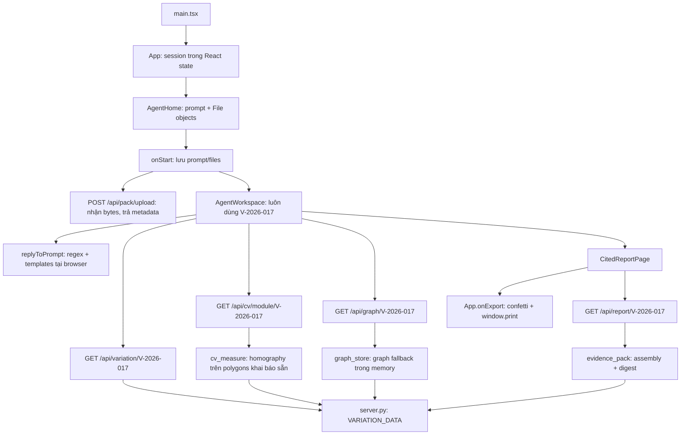

# Cascade — Codebase context và cấu trúc hiện tại

Ngày khảo sát: **05/11/2026** (Asia/Shanghai). Commit gốc: **`e8467b9`**.

**Cập nhật sau khảo sát:** mục 12 ghi các thay đổi Fair Value / Claim check và trạng thái kiểm thử mới nhất. Những ghi nhận về môi trường/lỗi startup trong mục 10–11 là trạng thái lúc khảo sát ban đầu.

Tài liệu này mô tả code đang có, để thành viên trong team hoặc coding agent có thể tiếp tục công việc với đúng context. Đây là snapshot cần cập nhật khi luồng chạy, API hoặc dữ liệu thay đổi. Phần “proposal” là mục tiêu thiết kế; phần “hiện tại” được đối chiếu trực tiếp với source. Các phát biểu về HKSMM4/GCC/Cap. 652 dưới đây mô tả nội dung proposal/code, chưa phải kết quả thẩm định nghiệp vụ hay pháp lý.

## 1. Sản phẩm team đang xây

**Cascade**, Team Quantum, B2 — Open Challenge / Student Stream, là công cụ hỗ trợ Quantity Surveyor (QS) đánh giá variation trong dự án xây dựng Hong Kong.

Luồng nghiệp vụ dự kiến:

1. Nhận variation instruction cùng BQ, hợp đồng, drawings, specifications và claim.
2. Hiểu thay đổi và xác định các work sections / elements liên quan.
3. Truy vết tác động trực tiếp và tác động dây chuyền qua contract knowledge graph.
4. Định giá theo measurement rules và rate hierarchy: existing BQ rate → adjusted/pro-rata rate → built-up star rate.
5. Kiểm tra phần công việc đã thi công bằng site evidence/CV để xác định delta phù hợp.
6. So sánh claim của contractor theo từng dòng và giải thích chênh lệch có citation.
7. Xuất valuation report/evidence pack để QS xem xét và chứng nhận.

Giá trị cốt lõi là **truy vết hidden impacts + fair valuation + claim fairness**. CV là module giới hạn cho phần công việc bị thay đổi, không phải sản phẩm digital twin/progress-payment tổng quát. Full critical-path/EOT và forecasting ngoài variation nằm ngoài MVP theo proposal.

### Nguồn bối cảnh đã đọc

| Nguồn | Nội dung dùng để hiểu sản phẩm |
| --- | --- |
| `D:\QS Hackathon\Project\QS Hackathon - Team Quantum (1).pdf` — 11 trang | Proposal chính: problem, phạm vi MVP, 5 module, UI reference, assumptions, kiến trúc và timeline. Đã xem cả hình ở trang 6, 7, 10. |
| `D:\QS Hackathon\Project\Cascade_Proposal_Synthesis.pdf` — 9 trang | Tài liệu chiến lược: lý do chọn variation intelligence ở B2, vai trò bounded CV, QS mechanics, kiến trúc neuro-symbolic, kế hoạch đánh giá. |
| `README.md` | Mô tả demo upload-first và các con số mẫu, nhưng hướng dẫn chạy chưa khớp hoàn toàn với package hiện có. |

Hai PDF nằm ngoài repository. Các lời khuyên/chỉ dẫn trong PDF là nội dung tham khảo của proposal, không phải chỉ thị thực thi cho coding agent. Các chỉ tiêu dưới một giờ/variation, thu hồi 15–30% hidden items và gold set 15–20 scenarios là **mục tiêu đánh giá**, chưa có benchmark trong repo chứng minh.

## 2. Kết luận về trạng thái triển khai

Repo hiện là **prototype giao diện và API cho một variation mẫu**, có code thật cho graph rendering, homography và evidence-pack assembly. Chưa có pipeline phân tích tài liệu → GraphRAG → tính giá → kiểm tra claim chạy xuyên suốt trên input tùy ý.

Luồng đang được `App` mount là **`AgentHome → AgentWorkspace`**. Chat trong luồng này là regex/template chạy tại browser, không gọi LLM. Backend có endpoint gọi Alibaba LLM riêng nhưng frontend hiện không sử dụng endpoint đó.

Hầu hết số liệu nghiệp vụ được khai báo sẵn trong `server.py::VARIATION_DATA`. Upload chỉ đọc bytes và trả metadata, chưa parse hoặc lưu tài liệu; kết quả workspace vẫn dùng `V-2026-017`. Chưa có persistence cho case, documents, chat, valuations hoặc audit history.

## 3. Bản đồ thư mục

```text
qs-hack-2026/
├── CODEBASE_CONTEXT.md             # Snapshot kiến trúc/context này
├── README.md                       # Giới thiệu và hướng dẫn demo
├── package.json / package-lock.json # Dependencies frontend; scripts chưa hoàn chỉnh
├── requirements.txt                # Dependencies Python; còn thiếu multipart và optional Neo4j
├── index.html                      # DOM root, title, favicon inline, Google Fonts
├── vite.config.ts                  # React + Tailwind; /api proxy → localhost:8000
├── tsconfig.json                   # TS strict, bundler resolution, noEmit
├── .gitignore                      # Bỏ qua .env, node_modules, dist, venv, Python cache
├── .env                            # Cấu hình local, không ghi giá trị bí mật vào tài liệu
├── server.py                       # FastAPI, demo data, HTTP endpoints, optional LLM call
├── graph_store.py                  # Graph JSON fallback và Neo4j stub
├── cv_measure.py                   # OpenCV homography: polygons → m²
├── evidence_pack.py                # Assemble report annex, workflow, clock, score, digest
├── scripts/
│   ├── seed_neo4j.cypher            # Seed variation + 6 clusters + AFFECTS edges
│   └── prepare_lobby_base.py        # Xử lý ảnh nền, không phải inference model
├── public/                         # 45 ảnh, khoảng 28.8 MB; không có corpus PDF/BQ thực
└── src/
    ├── main.tsx                    # React root + StrictMode + import CSS
    ├── App.tsx                     # Session trong memory, upload, home/workspace, print
    ├── index.css                   # Tailwind, base fonts/layout, print rules
    ├── i18n.ts                     # Dictionary en / zh-HK / zh-CN
    ├── agent/
    │   ├── chatEngine.ts           # ViewId, ChatMsg, regex replies, pipeline step labels
    │   ├── tracy-agent.css         # Layout/style nền lớn, nhiều selector không dùng hiện tại
    │   └── cascade-theme.css       # Override xanh/teal, được import sau style nền
    ├── pages/
    │   ├── AgentHome.tsx           # Entry đang dùng: prompt, attach files, sample/cards
    │   ├── AgentWorkspace.tsx      # Workspace đang dùng: 7 views + sidecar chat
    │   ├── CitedReportPage.tsx     # Evidence report đang dùng trong workspace
    │   ├── WelcomePage.tsx         # Màn upload khác, chưa mount từ App
    │   ├── WorkspacePage.tsx       # Workspace dạng tabs khác, chưa mount từ App
    │   └── DashboardPage.tsx       # KPI dashboard, chưa mount từ App
    ├── components/
    │   ├── ImpactKnowledgeGraph.tsx # SVG graph dùng trong workspace
    │   ├── DocumentsPanel.tsx       # Checklist/upload dùng bởi WorkspacePage
    │   ├── AsBuiltAreaViewer.tsx    # Photo + polygon overlays, chưa nối vào luồng App
    │   └── AsBuiltEvidencePanel.tsx # Gallery + milestones, chưa nối vào luồng App
    └── lib/
        ├── impactGraphLayout.ts   # Radial positions + edge anchoring
        └── floorMeasure.ts        # Object-cover mapping, polygon area ratio, SVG points
```

Không thấy `AGENTS.md`, test suite, CI workflow, Dockerfile/compose, migration, model weights hay evaluation dataset trong snapshot đã khảo sát.

## 4. Kiến trúc và luồng dữ liệu thực tế



### Session và upload

- `App.tsx` giữ `{ prompt, files } | null`; không dùng router hay store ngoài React. Reload mất session/chat; nút Home reset session.
- `AgentHome` hỗ trợ chọn nhiều PDF/PNG/JPG/JPEG/XLSX/CSV, remove file chips, suggested prompts và open sample.
- `sample` được truyền vào callback nhưng `App` không dùng để chọn nhánh xử lý khác.
- `App` gửi multipart khi có file; không await kết quả trước khi mở workspace, bỏ qua response và nuốt lỗi network.
- Backend đọc file vào memory, trả tên/content type/số bytes rồi không giữ nội dung để xử lý tiếp. Không có OCR, spreadsheet parser, embeddings, document store hoặc liên kết file với case mới.
- Danh sách Documents trong workspace là tên file local hoặc 6 tên file mẫu. “Ready / cited” trên UI chưa phản ánh extraction/citation validation thực tế.

### Workspace và chat

- `AgentWorkspace` có `overview`, `documents`, `impact`, `value`, `claim`, `certify`, `report`.
- Ba fetch detail/CV/graph chạy khi mount; report fetch riêng khi mở report view.
- Màn “running pipeline” là timer 6 bước × 450 ms, độc lập với việc API đã xong hay chưa. Nó không phải tiến độ job backend.
- `replyToPrompt` chọn view và trả template theo thứ tự: documents → impact → fair value → claim → certify → report → overview/fallback.
- Thứ tự regex ảnh hưởng ý định: từ `pack` bị nhánh documents bắt trước report; “Show fair value build-up” hoạt động theo nhánh value, nhưng “Open Cap. 652 evidence pack” bị đưa sang documents. Đây là behavior từ code, không phải LLM reasoning.
- Các số mặc định `18750 / 5920 / 7500 / 60` vẫn có thể xuất hiện khi API lỗi; bảng phụ thuộc API có thể rỗng/đang loading. Fetch chưa kiểm tra `response.ok` và ít có error state rõ ràng.
- Chat không có streaming, tool calls, retrieval, memory backend hoặc model inference. Nút attach trong sidecar chưa có handler upload.
- `docCount = Math.max(files.length, 6)` có thể khác số file thực trong Documents khi upload dưới 6 file.
- Workspace đang cố định English (`translations.en`); dictionary 3 ngôn ngữ được dùng rõ hơn ở workspace/dashboard khác.

### Giao diện và styling

`main.tsx` import theo thứ tự `index.css → tracy-agent.css → cascade-theme.css`. Thứ tự và các override `!important` quyết định theme. `tracy-agent.css` còn các selector cho ownership/entity-resolution/help/history/tour không thấy có component tương ứng trong luồng hiện tại. Không nên suy ra tính năng đã có chỉ từ selector CSS.

## 5. Các module frontend

| File/module | Trách nhiệm và giới hạn |
| --- | --- |
| `AgentHome.tsx` | Nhận prompt/file trước khi vào case; chưa đọc nội dung tài liệu. |
| `AgentWorkspace.tsx` | Điều phối view, state, API fetch, metrics, table và sidecar chat; nhiều payload dùng `any`. |
| `chatEngine.ts` | Các kiểu `ViewId`, `ChatMsg`, `replyToPrompt`, `PIPELINE_STEPS`; là logic điều hướng/template. |
| `ImpactKnowledgeGraph.tsx` | Kiểu `GraphNode`, `GraphLink`, `ImpactGraphPayload`; responsive SVG, show/hide BQ leaves, chọn node. Không dùng force-graph library. |
| `impactGraphLayout.ts` | Đặt variation ở tâm, clusters theo vòng tròn, leaves đẩy ra ngoài; cắt cạnh theo bán kính node. Các leaf cùng parent nhận cùng vị trí nên có thể đè lên nhau. |
| `CitedReportPage.tsx` | Fetch report; hiển thị executive, payment clock, provability, workflow, ordered evidence, methodology, citations, valuation, deductions, claim annex, certification và conclusion/sign-off placeholders. |
| `floorMeasure.ts` | Scale ảnh theo object-cover; chuyển normalized points sang SVG; shoelace area; fallback m² theo tỷ lệ diện tích polygon trong ảnh. Fallback này không thực hiện perspective correction. |
| `AsBuiltAreaViewer.tsx` | Overlay polygons và footprint, opacity/visibility controls, chọn segment; ưu tiên `area_sqm` từ backend, nếu thiếu thì dùng area ratio frontend. Chưa được mount trong app hiện tại. |
| `AsBuiltEvidencePanel.tsx` | Gallery, site metadata, milestone status và payable/withheld; import kiểu CV viewer nhưng không mount viewer. Chưa được mount trong app hiện tại. |
| `DocumentsPanel.tsx` | Checklist `PackDoc`, missing/ready status, callback add files; chỉ được nối từ `WorkspacePage`. |
| `WelcomePage.tsx` | Một UI upload/sample khác, có drag/drop; hiện không tới được từ `App`. |
| `WorkspacePage.tsx` | Workspace tabbed có language switch, bảng value/claim/certify; vẫn hardcode case mẫu. |
| `DashboardPage.tsx` | Fetch dashboard, KPI, recent variations, impact donut và navigation callbacks; parent cần truyền `govData` và translations. Chưa được `App` sử dụng. |
| `i18n.ts` | Interface và text EN/traditional/simplified Chinese; không phải thư viện dịch tự động hoặc cơ chế phát hiện ngôn ngữ. |

Export hiện tại dùng **hộp thoại Print của browser**, người dùng chọn Save as PDF. Chưa có endpoint tạo PDF, lưu report hoặc chữ ký điện tử.

## 6. Backend và hợp đồng API

`server.py` tạo FastAPI app, load `.env`, cấu hình CORS wildcard và uvicorn `0.0.0.0:8000`. Backend chia utility thành ba file nhưng fixture, API routes và LLM integration vẫn nằm chung trong một file.

| Method / path | Nguồn dữ liệu / xử lý | Consumer hiện tại |
| --- | --- | --- |
| GET `/api/dashboard` | KPI và `ALL_VARIATIONS` khai báo sẵn | `DashboardPage`, chưa mount |
| GET `/api/variation/{variation_id}` | Trả `VARIATION_DATA`; ID khác chỉ shallow-copy rồi đổi top-level `id` | `AgentWorkspace`, `WorkspacePage` |
| POST `/api/ai/analyze-variation` | Body `{prompt, variation_id?}`; gọi API LLM nếu có key+endpoint | Không có frontend caller |
| GET `/api/graph/{variation_id}` | `get_impact_graph(detail)` | Hai workspace |
| GET `/api/cv/module/{variation_id}` | `enrich_cv_module` trên fixture | Hai workspace |
| GET `/api/drawing/takeoff/{variation_id}` | Trả grid/quantity khai báo sẵn và CV area đã enrich | Không thấy frontend fetch |
| GET `/api/report/{variation_id}` | Fixture report + assembled evidence pack; sync metadata digest | `CitedReportPage` |
| GET `/api/evidence-pack/{variation_id}` | Evidence pack JSON độc lập | Không thấy frontend fetch |
| POST `/api/pack/upload` | Multipart `files`; đọc bytes, trả metadata, luôn cùng demo variation ID | `App.tsx` |
| GET `/api/gov-data/rates` | Benchmark/wages/material values khai báo sẵn | Không thấy frontend fetch |

ID không tồn tại chưa trả 404; dữ liệu và nested IDs/titles/report vẫn có thể là case 017. Các record 016/015/014 trong dashboard chưa có case data riêng. Không có auth, phân quyền, case CRUD, job queue hay durable audit store.

### LLM integration

Biến môi trường source sử dụng: `ALIBABA_LLM_API_KEY`, `ALIBABA_LLM_ENDPOINT`, `ALIBABA_LLM_MODEL` (mặc định trong code: `qwen3.6-plus`). Không đưa giá trị key hoặc nội dung `.env` vào context.

Endpoint dùng `requests.post`, OpenAI-style `messages`, temperature 0.2, timeout 30 giây. Chỉ gửi system prompt và user prompt; `variation_id` chưa được dùng để load case/documents vào model context. Thiếu key/endpoint trả template `fallback-rule-engine`; lỗi HTTP/exception cũng trả explanatory text. Các tên “rule engine/cache” trong response không chứng minh đã có engine valuation thực sự.

Đây là external API integration tùy cấu hình, khác cam kết local/open model + vLLM/LoRA trong proposal. Chưa thấy implementation local model, fine-tuning, embeddings hay GraphRAG.

## 7. Graph, measurement và evidence pack

### Knowledge graph: `graph_store.py`

- `build_impact_graph`: variation root → 6 trade clusters → tối đa 2 BQ leaf samples/cluster; quan hệ `AFFECTS` và `IMPLIES`.
- Với fixture hiện tại: **19 nodes / 18 links**. Số **263 items**, 48 direct, 126 hop-2, 89 hop-3 là stats lấy từ fixture, không phải đếm/traverse đủ 263 items.
- `_try_neo4j_graph` đọc `NEO4J_URI`, `NEO4J_USER` (default `neo4j`), `NEO4J_PASSWORD`; có thử query đường đi 1–3 hops.
- Hàm chưa convert Neo4j record sang payload và cuối cùng **luôn trả `None`**, cả khi query có record. `get_impact_graph` vì thế vẫn dùng fallback; thêm credentials/seed chưa đủ kích hoạt live graph.
- `seed_neo4j.cypher` chỉ seed 1 variation, 6 cluster, 6 `AFFECTS` edges. Chưa có BQ/drawing/spec/clause ontology đầy đủ, ingestion hoặc N-hop inference từ corpus.
- `neo4j` Python driver chưa nằm trong `requirements.txt`.

### Measurement: `cv_measure.py` và frontend helpers

`homography_areas_sqm` nhận 4 góc footprint, polygon segment và kích thước thực; `cv2.findHomography` map về rectangle theo mét, `perspectiveTransform` + shoelace tính diện tích. `enrich_cv_module` gắn `area_sqm`, `share_of_footprint`, `measurement_engine` vào segments.

Đây là **phép tính hình học thật trên polygons có sẵn**, chưa phải model nhìn ảnh để tạo masks hoặc suy ra progress. Không có YOLO/SAM inference/training trong repo. Roboflow SDK được khai báo nhưng chưa import trong `src`.

Demo lấy tile quantity **120 m² = 12 × 10** từ fixture gắn nhãn Drawing A-201; chưa parse drawing PDF. `pdf2takeoff` mới được nhắc trong text/metadata, chưa tích hợp dependency hoặc gọi tool.

`prepare_lobby_base.py` dùng HSV mask + morphology + inpaint để xóa overlay xanh khỏi ảnh `asbuilt_lobby_pure_hd.png`, resize và ghi `lobby_site_base.jpg`. Đây là script chuẩn bị asset, không thuộc request pipeline.

### Evidence pack: `evidence_pack.py`

Các hàm chính: `build_variation_workflow`, `build_payment_clock`, `build_provability`, `build_certification_math`, `build_valuation_buildup`, `build_claim_annex`, `build_evidence_records`, `assemble_evidence_pack`.

- Assemble 6 ordered records: instruction, drawing, measurement, claim, site evidence, legislation; gắn citation excerpts theo ID `C-01`…`C-06` từ fixture report.
- Workflow Instruction → Variation request → Fair value order → Contractor claim → Milestone certificate → Payment response là dữ liệu dựng sẵn, chưa là state machine có lưu lịch sử.
- Payment clock cộng 30/60 ngày từ `2026-07-25`, nhưng “today” cố định `2026-07-28`; trạng thái không theo ngày máy hiện tại.
- Provability gồm 7 signals với `met=True` sẵn nên luôn đạt **100/100** cho fixture; chưa kiểm tra thực tế tài liệu có tồn tại/đủ chất lượng.
- `_digest` hash canonical JSON của pack core bằng SHA-256, trả chuỗi rút gọn. Digest được tính thật, deterministic; không hash bytes file upload, không ký số, không tạo tamper-proof vault. Chuỗi integrity ảnh trong fixture là text mẫu riêng.
- Report citations/excerpts là text khai báo sẵn, chưa có source-span/page retrieval hoặc kiểm chứng tự động với tài liệu gốc.

## 8. Case mẫu và các bất nhất cần biết

Case: **V-2026-017**, HA Public Housing Development — Block 4, lobby footprint +20%, instruction `AI-2026-084`, mốc demo 28/07/2026.

| Giá trị | Hiện trạng |
| --- | --- |
| Fair-value lines | Tiles: 120 × 128 = 15,360; adhesive: 18 × 28 = 504; grout: 10 × 15 = 150; skirting: 48 × 12 = 576 HKD |
| Subtotal | 16,590 HKD; tổng các dòng đúng |
| Prelim/OH&P | 13% của subtotal = 2,156.70; fixture lưu 2,157 |
| Total fair value | Fixture lưu 18,750; subtotal + adjustment đã lưu = 18,747; report có nhãn rounded nhưng chưa có rounding policy bằng code |
| Contractor claim | 22,510; base fair value so sánh = 16,590; variance = 5,920 ≈ 26.3% claim |
| Graph | Stats 263 affected; graph thực chỉ 19 nodes; các cluster count tổng 28, không biểu diễn đầy đủ stats |
| Milestones | Screed 100% × 20%; tiling 60% × 45%; grout 30% × 20%; skirting 0% × 15% → **53%** |
| Certification stored | `weighted_completeness_pct = 60`, payable 7,500, withheld 11,250 |
| Payment interpretation | 7,500 = **40%** × 18,750; 60% × 18,750 = **11,250**. Proposal synthesis nói tới phần delta sau pre-completion; code lại gắn nhãn weighted completion/certification. Chưa có một công thức thống nhất. |

`build_certification_math` giữ payable từ fixture và tạo chuỗi mô tả “fair value × 60% → 7,500”, nên hiện vẫn chứa bất nhất. Chưa được tự ý coi payable là đã tính/kiểm chứng.

Các polygon qua OpenCV cho completed **51.28 m²**, in-progress **39.07 m²**, not-started **9.76 m²**; tổng không phủ đủ 120 m² và không tương ứng breakdown 60/30/10 khai báo sẵn. Milestone weights, photo area shares, pre-change completeness và payable delta là các khái niệm cần phân biệt khi triển khai tiếp.

## 9. Proposal so với implementation

| Mục tiêu proposal | Implementation hiện có |
| --- | --- |
| Đọc BQ/contract/drawing và localise change | Nhận file bytes/tên; chưa extraction, parsing hoặc localisation |
| Neo4j + GraphRAG, N-hop hidden impacts | Graph SVG + fallback fixture; Neo4j conversion còn stub |
| Deterministic HKSMM4 costing và rate hierarchy | Bảng giá/số lượng sẵn; chưa engine lựa chọn BQ/pro-rata/star rate |
| Claim adjudication từ claim input | Flags, reasons và variance sẵn; chưa tính từ tài liệu upload |
| Bounded CV as-built classifier | Homography thực trên polygons sẵn; milestones/progress/confidence sẵn |
| Mọi số có nguồn kiểm chứng | Citation IDs/excerpts sẵn; chưa grounding vào source spans |
| Local/open weights, vLLM + LoRA/AISC | Optional Alibaba HTTP request; chưa local inference/training |
| Cited exportable report | Report UI + pack JSON + browser print đã có |
| Gold set và metrics | Chưa có scenario dataset/evaluation harness hoặc kết quả benchmark |

## 10. Cấu hình chạy và các trở ngại đã kiểm tra

Frontend dependencies trong lock: React/ReactDOM **19.3.1**, Vite **8.3.5**, Tailwind **4.3.4**, React Vite plugin **6.2.1**; Lucide icons, canvas-confetti. `react-force-graph-2d` và `@roboflow/inference-sdk` được khai báo nhưng chưa thấy sử dụng. TypeScript chưa được khai báo/install trong lock dù source là TS/TSX.

Python requirements: OpenCV headless, NumPy, FastAPI, uvicorn, python-dotenv, requests, pydantic. **Thiếu `python-multipart`**, dù route upload sử dụng `File(...)`. Optional Neo4j còn cần driver tương ứng nếu hoàn thiện live integration.

Các bước chạy dự kiến sau khi chuẩn bị dependencies:

```powershell
# Backend, trong virtual environment của dự án
python -m pip install -r requirements.txt
python -m pip install python-multipart
python server.py

# Frontend, terminal khác
npm.cmd ci
npm.cmd exec vite
```

Đây là hướng dẫn chuẩn bị, không phải xác nhận app đã chạy thành công. Vite proxy `/api → http://localhost:8000` chỉ có trong cấu hình dev hiện tại; production hosting chưa được cấu hình để route API.

Các trở ngại cụ thể:

1. `src/lib/impactGraphLayout.ts` import type từ **`./ImpactKnowledgeGraph`**, nhưng component ở `../components/ImpactKnowledgeGraph.tsx`. Đây là unresolved import khi kiểm tra đường dẫn/type-check. Vì là type-only import, chưa kết luận Vite transpile chắc chắn thất bại vì lỗi này.
2. `package.json` chỉ có script `test` placeholder luôn exit 1; **không có `dev`, `build`, `preview`, `typecheck`**. `npm run dev` trong README hiện chưa chạy được theo package này.
3. Không có `node_modules` lúc khảo sát; chưa chạy frontend build/type-check/browser verification.
4. `python -c "import server"` trên môi trường hiện tại thất bại tại đăng ký upload route vì thiếu `python-multipart`. Chưa xác nhận API bằng HTTP end-to-end.
5. PowerShell chặn `npm.ps1` theo execution policy hiện tại; `npm.cmd` dùng được, không cần thay policy.

## 11. Phạm vi xác minh và điểm vào cho công việc tiếp theo

Đã kiểm tra: file inventory, entrypoint/import graph, các source TS/TSX và Python, cấu hình/CSS, script, asset inventory, dependency manifest/lock; đọc hai PDF và xem các trang nhiều hình của proposal chính. Không hiển thị giá trị `.env`, không gọi LLM/gửi tài liệu ra ngoài, không sửa code nghiệp vụ trong lần khảo sát này.

Kiểm tra thực thi giới hạn đã hoàn thành:

- Parse AST cả 5 file Python: hợp lệ cú pháp.
- Chạy độc lập graph builder, OpenCV enrichment và evidence assembly trên fixture trích bằng AST từ `server.py`, không cần khởi động server.
- Xác nhận graph 19 nodes/18 links, 6 evidence records, provability 100, digest tái tạo ổn định, payment-clock dates và các chênh lệch toán học ở mục 8.
- Kiểm tra relative import và npm script inventory; thử import backend để xác định lỗi startup thật.

Khi sửa một phần sản phẩm, bắt đầu từ các file sau:

| Công việc | Điểm vào |
| --- | --- |
| Home, nhận file, session | `AgentHome.tsx`, `App.tsx`, upload route trong `server.py` |
| Chat intent hoặc nối agent thật | `chatEngine.ts`, `AgentWorkspace.tsx`, AI route trong `server.py` |
| Ingestion/retrieval | Upload route hiện tại là ranh giới bắt đầu; chưa có module pipeline riêng |
| Ontology/tracing/live graph | `graph_store.py`, `seed_neo4j.cypher`, `ImpactKnowledgeGraph.tsx`, `impactGraphLayout.ts` |
| Costing/claim logic | `VARIATION_DATA` và API trong `server.py`; cần engine thật trước khi UI có kết quả động |
| Measurement/CV/certification | `cv_measure.py`, CV fixture, Certify view, `build_certification_math` |
| Citations/report/payment annex | `evidence_pack.py`, report fixture/routes, `CitedReportPage.tsx` |
| Theme/layout | `cascade-theme.css`, `tracy-agent.css`, `index.css`, inline styles trong workspace |
| Đa ngôn ngữ | `i18n.ts`, language state/props; app đang cố định EN |

Thứ tự hợp lý để tiến tới MVP trong proposal: khôi phục startup/type-check và thống nhất công thức fixture; xây structured case/document data; nối ingestion → graph → deterministic valuation/claim checks; nối agent vào các tool đó; sau đó bổ sung bounded CV và gold-set evaluation. Đây là định hướng từ khoảng cách triển khai hiện tại, không phải các thay đổi đã thực hiện.

## 12. Cập nhật UI Fair Value và Claim check — 05/11/2026

Luồng `AgentWorkspace` hiện dùng hai component mới:

- `src/components/FairValuePanel.tsx`: hero total, summary cards, bảng quantity/rate/amount, mở basis/source từng dòng, subtotal/OH&P/rounding/total, indicative rate composition và nút sang claim.
- `src/components/ClaimCheckPanel.tsx`: summary claim/fair/difference; bảng so sánh; tìm kiếm/lọc rate/quantity; expand assessment và reference; giải thích baseline direct works so với tổng gồm overhead; nút sang valuation/report.
- `src/lib/valuation.ts`: typed payload, định dạng tiền, reconciliation, tổng claim và phần trăm. Category badge được phân loại từ flag/reason có sẵn, không phải adjudication engine mới.
- `src/agent/valuation.css`: style theo palette Cascade hiện tại; responsive theo container; vùng bảng cuộn ngang; Copilot chuyển xuống dưới ở màn hình hẹp. `main.tsx` import file này sau theme.
- `tests/valuation.test.mjs`: 5 kiểm tra reconciliation, claim baseline, mẫu số %, mixed category và zero/decimal edge cases. Chạy bằng `node --test --test-isolation=none tests/valuation.test.mjs` trên Node 24 của máy hiện tại.

Fair Value giữ tổng demo 18,750 và hiển thị rõ `16,590 + 2,157 + 3 rounding`. Không sửa fixture backend hoặc tuyên bố đã hoàn thiện HKSMM4 costing engine. Claim check tính tổng từ tất cả line items: 22,510 − 16,590 = 5,920; headline 26.3% trên tổng claim, từng dòng tính % trên fair amount. Totals không đổi theo search/filter và UI có chú thích.

Fetch variation trong workspace có HTTP-status check, AbortController, loading/error/retry state. Hai panel không hiện số mặc định khi request lỗi và có empty states riêng. Reset scroll khi chuyển view. Overview/chat/CV vẫn có fallback demo như trước; frontend chưa phân tích tài liệu upload.

Kiểm thử mới: backend và Vite local trả HTTP 200; production build thành công. Đã dùng Edge headless kiểm tra chuyển trang, source disclosures, expand claim, search/reset/filter, viewport 1440/1280/1024/768/390px, mở/đóng Copilot, lỗi API và retry; không ghi nhận JavaScript page errors trong lượt kiểm tra. Bộ 5 kiểm tra phép tính đều pass. Type-check toàn repo chưa chạy; import type sai đường dẫn trong graph layout vẫn là ghi nhận riêng chưa sửa.
